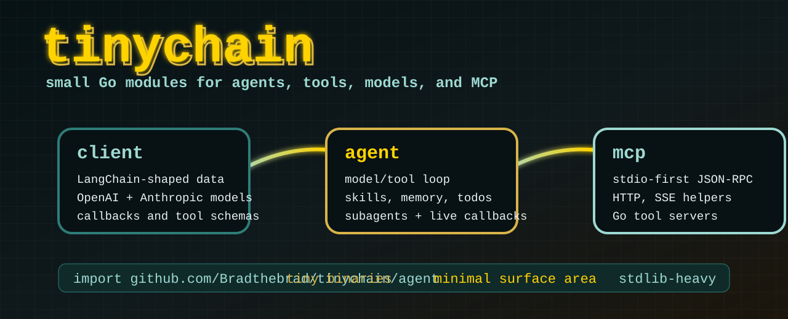

# tinychain



`tinychain` is a tiny Go module for building LangChain-shaped clients, agents, skills, tools, and MCP-style tool servers without dragging a whole ecosystem into your binary.

It is intentionally boring in the best way: small structs, explicit interfaces, stdlib-first networking, and just enough agent loop to build real local apps like NullBot.

## Packages

| Package | Import path | Purpose |
| --- | --- | --- |
| `lc` | `github.com/Bradthebrad/tinychain/lc` | LangChain-shaped message/data models, content blocks, tool calls, generations, and helpers. |
| `callbacks` | `github.com/Bradthebrad/tinychain/callbacks` | LangChain-like model/tool activity events. |
| `openai` | `github.com/Bradthebrad/tinychain/openai` | OpenAI Chat Completions and Responses request/response structs plus a tiny HTTP client. |
| `anthropic` | `github.com/Bradthebrad/tinychain/anthropic` | Anthropic Messages request/response structs plus a tiny HTTP client. |
| `agent` | `github.com/Bradthebrad/tinychain/agent` | Minimal model/tool loop with skills, memory prompt injection, todo planning, subagent task delegation, and callback events. |
| `mcp` | `github.com/Bradthebrad/tinychain/mcp` | Minimal MCP-style JSON-RPC protocol, stdio-first server/client transport, HTTP/SSE helpers, and adapters that expose MCP tools to agents. |

The repository is one Go module, so consumers can build from a single clone or let `go mod` pull the tagged module automatically.

## Design Goals

| Goal | What that means here |
| --- | --- |
| Tiny binaries | No framework pileup, no giant runtime, no reflection-heavy abstraction maze. |
| LangChain-shaped data | Familiar message, content, tool-call, generation, and callback models in Go structs. |
| Provider escape hatches | OpenAI and Anthropic request/response shapes are represented directly; OpenAI-compatible base URLs can be supplied by callers. |
| Explicit tools | Tools are plain Go interfaces and functions with JSON-schema-ish definitions. |
| Skills as files | `SKILL.md` files can be loaded into the agent prompt without making skills a complex plugin system. |
| MCP first, but minimal | Stdio is the default transport; HTTP/SSE style transports are available for servers that need them. |

## Client Packages

The client packages contain the data models and provider clients:

| Package | What it includes |
| --- | --- |
| `lc` | `BaseMessage`, content blocks, tool calls, tool definitions, generations, and helper constructors. |
| `callbacks` | LangChain-like activity events for chat model start/end/error and tool start/end/error. |
| `openai` | Chat Completions and Responses API request/response structs plus a tiny HTTP client. |
| `anthropic` | Anthropic Messages request/response structs plus a tiny HTTP client. |

The OpenAI client defaults to `https://api.openai.com/v1`, but `BaseURL` is configurable for OpenAI-compatible providers.

## Agent

The `agent` module is the smallest useful agent loop:

```go
package main

import (
	"context"
	"fmt"

	"github.com/Bradthebrad/tinychain/agent"
)

func main() {
	echo := agent.ToolFunc{
		Name:        "echo",
		Description: "Echo input back to the model.",
		Schema:      agent.ToolSchema(map[string]any{"text": agent.StringProperty("Text to echo.")}, "text"),
		Func: func(ctx context.Context, args map[string]any) (string, error) {
			return fmt.Sprint(args["text"]), nil
		},
	}

	a := agent.New(agent.Config{
		Model:        myModel{},
		SystemPrompt: "You are concise.",
		Tools:        []agent.Tool{echo},
	})

	result, err := a.Invoke(context.Background(), "say hello")
	if err != nil {
		panic(err)
	}
	fmt.Println(result.Output.Text())
}
```

In the example above, `myModel` is any type that implements `agent.Model`.

Agent features include:

| Feature | Detail |
| --- | --- |
| Tool loop | Calls a model, executes requested tools, appends tool results, repeats until final output or max iterations. |
| Built-in todo tool | Includes `write_todos` for lightweight planning state. |
| Skills | Loads `SKILL.md` instructions and composes them into the system prompt. |
| Memory | Injects compact memory snippets into the system prompt. |
| Subagents | Adds a task tool when subagents are configured, so a supervising agent can delegate focused work. |
| Callbacks | Emits model/tool start, end, and error events suitable for live UIs and logs. |
| Context management | Measures context use before every model call, counting tool definitions and rescaling by the input tokens the provider reports. Shortens tool results the model has seen from 60% of the window, summarizes older messages from 85%, and cuts any tool result that wouldn't fit to a preview with its size. See below. |

## Context management

Set `Config.Context` to manage a long run's context:

```go
agent.ContextPolicy{
	Enabled:       true,
	MaxTokens:     200000,                 // the model's context window
	SoftRatio:     0.60,                   // shorten from here
	HardRatio:     0.85,                   // summarize from here
	PreserveTools: []string{"skill_read"}, // never shorten these results
	Note:          "Full history is searchable with history_search.",
}
```

Before every model call the agent estimates the request: messages plus tool
definitions, at about four characters per token, scaled by what the provider
reported for the previous request (cache reads and writes included).

| Tier | When | What happens |
| --- | --- | --- |
| Shorten | Usage at `SoftRatio` or more, or `MaxMessages` reached | Tool results the model has already seen become a digest: the tool, its arguments, the size of the output and its first `ToolDigestChars` characters. Long string arguments of earlier tool calls are cut to `ToolArgChars`. Oldest first, until usage is three quarters of `SoftRatio`. No model call. |
| Summarize | Still at `HardRatio` or more | Older messages are replaced by a model-written summary. About `RecentRatio` of the window stays word for word. Skill results and the request being worked on are carried over word for word in their own message, and a later summary folds the earlier one in. |
| Guard | Every tool result, as it arrives | A result larger than the room left (counting what shortening could free), or than half the window, is cut to a preview with a notice giving its size and suggesting a smaller read. |

A context-length error triggers both tiers and one retry. When the error names
the real window ("maximum context length is 128000 tokens"), the agent uses
that window for the rest of the run.

`Agent.Compact` runs the same passes on demand, for a compaction a person asks
for. Callbacks report each pass as a `context_shorten` or `context_compaction`
chain event, and every model start carries `context_tokens`,
`context_window`, `shorten_at` and `summarize_at` in `Data.Extra`.

## MCP

The `mcp` module is for small tool binaries and local tool marketplaces:

| Capability | Detail |
| --- | --- |
| Stdio by default | Build command-line MCP servers that speak JSON-RPC over stdin/stdout. |
| HTTP/SSE helpers | Run or connect over stream-oriented HTTP transports when stdio is not enough. |
| Server API | Register tools as Go functions with names, descriptions, schemas, and handlers. |
| Client API | Connect to a server, list tools, and call tools. |
| Agent adapter | Convert MCP tools into `agent.Tool` values so agents can use external servers. |

This is intentionally not a full MCP kitchen sink. It is the smallest practical base for Go tool servers that can be compiled and dropped into another app.

## Repository Layout

```text
tinychain/
  assets/
    tinychain-hero.svg
  anthropic/
  callbacks/
  lc/
  openai/
  agent/
  examples/
    openai_example_agent/
  mcp/
```

## Tiny OpenAI Example Agent

The repo includes a baby-sized CLI REPL example that uses the `agent` and client packages directly:

```powershell
cd examples/openai_example_agent
go run . -api-key sk-your-key
```

It defaults to `gpt-4o-mini` and supports:

| Flag | Purpose |
| --- | --- |
| `-api-key` | OpenAI API key. Falls back to `OPENAI_API_KEY`. |
| `-model` | Model name. Defaults to `gpt-4o-mini`. |
| `-base-url` | OpenAI-compatible base URL. |
| `-responses` | Use the Responses API instead of Chat Completions. |
| `-system` | Override the system prompt. |

Build the release executable:

```powershell
cd examples/openai_example_agent
go build -trimpath -ldflags "-s -w" -o ..\..\openai_example_agent.exe .
```

There is also an even smaller direct chat REPL that skips the agent layer and calls the OpenAI client directly:

```powershell
cd examples/openai_example_chat
go run . -api-key sk-your-key
go build -trimpath -ldflags "-s -w" -o ..\..\openai_example_chat.exe .
```

## Tests

Run all tests from the repository root:

```powershell
go test ./...
```

## Non-Goals

`tinychain` is not trying to be a complete LangChain port, a hosted model registry, a heavyweight graph runtime, or a batteries-included coding agent. The point is the opposite: keep the core tiny and let applications compose only the pieces they actually want.
